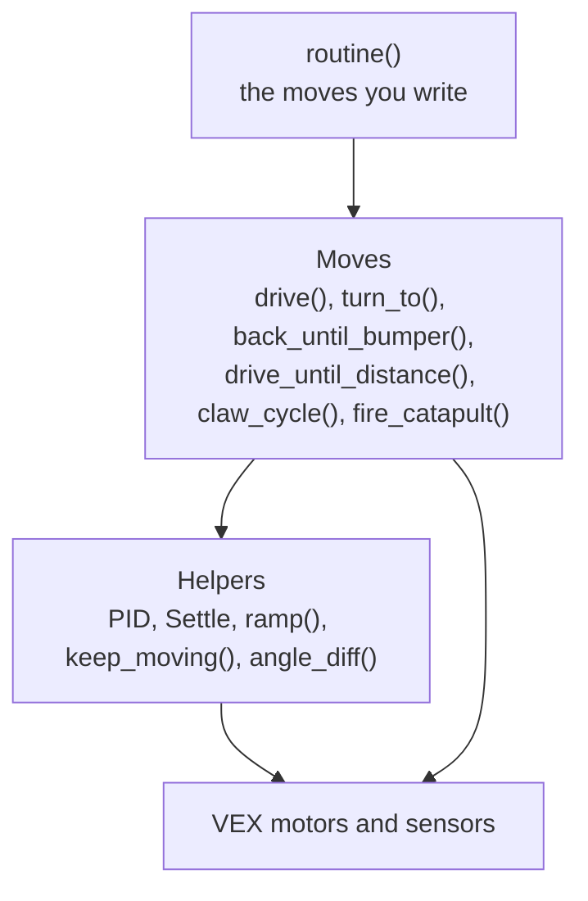

# Lessons: how the 530vex program works

These lessons explain every part of [`src/main.py`](../src/main.py): what each function does, how
it works, the math behind it, and why it was built that way.

They are written for students who know a little Python (variables, `if`, loops, functions), and
for the coach who teaches them.

## Start here

1. **Use the robot first.** Read the [robot guide](robot-guide.md). It shows how to start the
   program, write a routine, test each part of the robot and tune the numbers. Students should drive
   the robot before they study how it works.
2. **Then look under the hood** with the lessons below, in order. Each one builds on the one
   before it.

## The lessons

| # | Lesson | The big question | Robot needed? |
|---|---|---|---|
| 1 | [The big picture](lessons/01-big-picture.md) | How is the program organized, and what happens when it starts? | No |
| 2 | [Measuring where the robot is](lessons/02-measuring.md) | How does the robot know how far it went and which way it faces? | Yes |
| 3 | [PID: fixing its own mistakes](lessons/03-pid.md) | How does the robot decide how much power to use? | Yes |
| 4 | [Smooth starts and clean stops](lessons/04-smooth-and-done.md) | How does it speed up without slipping, and how does it know it's done? | Yes |
| 5 | [Turning and driving](lessons/05-turning-and-driving.md) | How do the pieces fit together into `turn_to()` and `drive()`? | Yes |
| 6 | [Letting sensors decide when to stop](lessons/06-sensor-stops.md) | How can walls and sensors fix the robot's mistakes? | Yes |
| 7 | [The claw and the catapult](lessons/07-mechanisms.md) | How do two motors run two different mechanisms? | Yes |
| 8 | [The screen and error messages](lessons/08-screen-and-start.md) | How does the brain's screen tell you what happened, even when the program crashes? | Helpful |
| 9 | [Thinking like a software engineer](lessons/09-engineering.md) | Why is the whole program built this way? | No |

Every lesson has the same parts:

- **The idea:** the problem, in plain words.
- **The code:** the real code from `src/main.py`, explained step by step.
- **The math:** worked examples that use the program's own numbers.
- **Why it's built this way:** the engineering reasons behind the choices.
- **Try it:** something to do on the robot or on paper.
- **Check your understanding:** questions, with the answers hidden until you click.
- **Teacher notes:** timing, common mistakes and what to watch for.

> **About the numbers:** the speeds and tuning numbers in the program (`TURN_KP`, `DRIVE_MAX_SPEED`
> and so on) are starting guesses. They have not been tested on the real robot yet. The lessons use
> them as examples. When you tune the robot your numbers will change, but the ideas stay the same.

## How the code is layered

Each layer only uses the layers below it. Students write the top layer. Everything else is the
"engine" that makes those moves accurate.

## Every function, and where it's explained

Functions are listed in the order they appear in `src/main.py`.

| Function | What it does | Lesson |
|---|---|---|
| `routine()` | The list of moves the robot does. Students edit this. | [1](lessons/01-big-picture.md) |
| `now_ms()` | Milliseconds since the program started. | [2](lessons/02-measuring.md) |
| `clamp()` | Keeps a number between a low and a high limit. | [2](lessons/02-measuring.md) |
| `angle_diff()` | The shortest turn from one heading to another. | [2](lessons/02-measuring.md) |
| `heading_now()` | Which way the robot faces, in degrees. | [2](lessons/02-measuring.md) |
| `set_heading()` | Tells the robot "you are facing this way now". | [2](lessons/02-measuring.md), [6](lessons/06-sensor-stops.md) |
| `report_problem()` | Counts a move that ran out of time. | [4](lessons/04-smooth-and-done.md) |
| `free_memory()` | How much memory the brain has left. Shown on the done and error screens. | [8](lessons/08-screen-and-start.md) |
| `PID` | Turns "how far off am I" into "how much power". | [3](lessons/03-pid.md) |
| `Settle` | Decides when a move is really finished. | [4](lessons/04-smooth-and-done.md) |
| `ramp()` | Speeds up a little at a time so the wheels don't slip. | [4](lessons/04-smooth-and-done.md) |
| `keep_moving()` | Makes sure there's enough power to actually move. | [4](lessons/04-smooth-and-done.md) |
| `setup_motors()` | Sets the motors to brake and full strength at the start. | [1](lessons/01-big-picture.md) |
| `drive_motors()` | Sends power to the left and right wheels. | [5](lessons/05-turning-and-driving.md) |
| `brake_drive()` | Stops the wheels. | [5](lessons/05-turning-and-driving.md) |
| `wheel_degrees()` | How far the wheels have turned. | [2](lessons/02-measuring.md) |
| `heading_correction()` | How much to steer to stay pointed the right way. | [5](lessons/05-turning-and-driving.md) |
| `turn_to()` | Spins in place to face a heading. | [5](lessons/05-turning-and-driving.md) |
| `drive()` | Drives a distance while holding a heading. | [5](lessons/05-turning-and-driving.md) |
| `back_until_bumper()` | Backs up until the bumper hits something. | [6](lessons/06-sensor-stops.md) |
| `drive_until_distance()` | Drives until the distance sensor sees something close. | [6](lessons/06-sensor-stops.md) |
| `mechanism_spin()` | Spins the two shared mechanism motors. | [7](lessons/07-mechanisms.md) |
| `mechanism_stop()` | Stops the two shared mechanism motors. | [7](lessons/07-mechanisms.md) |
| `claw_open()` / `claw_close()` | Opens or closes the claw with air. | [7](lessons/07-mechanisms.md) |
| `set_catapult_level()` | Picks catapult level 3 or 4. | [7](lessons/07-mechanisms.md) |
| `start_mechanisms()` | Opens the claw and picks catapult level 4. It does not fire. | [7](lessons/07-mechanisms.md) |
| `fire_catapult()` | Fires the catapult and winds it back down. | [7](lessons/07-mechanisms.md) |
| `claw_cycle()` | Grabs, flips over, lets go and swings back. | [7](lessons/07-mechanisms.md) |
| `show()` | Writes up to 6 lines on the brain screen. | [8](lessons/08-screen-and-start.md) |
| `wait_release()` | Waits until a button is let go. | [8](lessons/08-screen-and-start.md) |
| `wait_for_check()` | Waits for one full press of the Check button (used by the INERTIAL BUSY warning). | [8](lessons/08-screen-and-start.md) |
| `show_result()` | Shows the done screen: time, heading, timeouts and memory left. | [8](lessons/08-screen-and-start.md) |
| `show_error()` | Stops the robot and shows the error on the brain screen. | [8](lessons/08-screen-and-start.md) |
| `wait_for_inertial()` | Waits for the heading sensor to get ready. | [2](lessons/02-measuring.md) |
| `run_routine()` | Gets the robot ready, runs `routine()`, then shows the done screen. | [1](lessons/01-big-picture.md) |
| `try` / `except` and `while True` at the end | Show any crash on the brain screen, then keep the last screen up until you press X. | [1](lessons/01-big-picture.md), [8](lessons/08-screen-and-start.md) |
