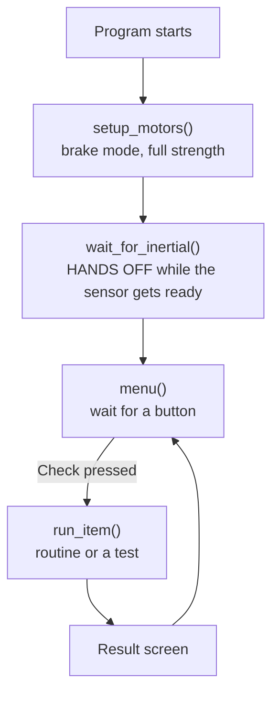

# Lesson 1: The big picture

**Big question:** How is the program organized, and what happens when it starts?

**In this lesson:** the file's sections, `setup_motors()`, `routine()`, and the last three lines
of [`src/main.py`](../../src/main.py).

---

## The idea

`src/main.py` is over 600 lines long. Nobody should read it top to bottom on day one. First learn
its **shape**: which parts it has, what each part is for, and which parts you're allowed to change.

Here's a surprise: **almost the whole file is definitions.** A `def` tells Python "here's how to do
something", but it doesn't do it yet. Nothing on the robot moves until the last three lines of the
file.

## The sections of the file

From top to bottom:

| Section | What's in it | Edit it? |
|---|---|---|
| Robot configuration | Which motor or sensor is plugged into which port | Only if the wiring changes |
| `SETTINGS` | All the numbers: speeds, distances, times, tuning | **Yes** |
| `routine()` | The moves the robot does | **Yes** |
| "DON'T EDIT BELOW THIS LINE" | The engine: everything that makes the moves work | Only when you know why |
| Helpers (lessons 2 to 4) | Time, angles, PID, settling | |
| Drive base (lesson 5) | `turn_to()`, `drive()` | |
| Sensor moves (lesson 6) | `back_until_bumper()`, `drive_until_distance()` | |
| Mechanisms (lesson 7) | Claw and catapult | |
| Brain screen and menu (lesson 8) | What you see and press on the brain | |
| The last three lines | Start the program | |

## The code

### Robot configuration

```python
L_motor_a = Motor(Ports.PORT5, False)
L_motor_b = Motor(Ports.PORT6, False)
L = MotorGroup(L_motor_a, L_motor_b)
R_motor_a = Motor(Ports.PORT11, True)
R_motor_b = Motor(Ports.PORT12, True)
R = MotorGroup(R_motor_a, R_motor_b)
```

- `Motor(Ports.PORT5, False)` means "there's a motor in port 5, and it is **not** reversed."
- The right motors say `True` (reversed). They're mounted as a mirror image of the left ones, so
  spinning "forward" would push the robot backward. Marking them reversed here means the rest of
  the program can say `FORWARD` for both sides and mean the same thing.
- `MotorGroup` joins two motors so they act as one. `L` is the whole left side, `R` the right.

The rest of the configuration names the other devices: `C_L` and `C_R` (the claw and catapult
motors), `pneumatic_9` (the air cylinders), `distance_3` (distance sensor), `Bumper_1` (bumper) and
`brain_inertial` (the heading sensor built into the brain).

### Settings

```python
TURN_KP = 0.9            # % per degree of error (higher = turns harder)
...
TURN_MAX_SPEED = 50
...
DRIVE_MAX_SPEED = 60
```

Settings are written in `ALL_CAPS`. In Python that's a signal that says "this number doesn't change
while the program runs." All of them sit at the top of the file so you can tune the robot without
digging through the engine.

### The routine

```python
def routine():
    start_mechanisms()       # open claw, arm catapult
    drive(600, 0)            # forward 600 mm, facing 0 degrees
    claw_cycle()             # grab, flip, release
    turn_to(90)              # face right
    drive(300, 90)
    fire_catapult()
    drive(-400, 90)          # negative = backward
    back_until_bumper(90)    # square up on the wall
```

A routine is a list of moves, done **one at a time, top to bottom**. Each move finishes before the
next one starts. `drive(600, 0)` doesn't return until the robot has driven 600 mm (or run out of
time).

The moves read almost like English. That's on purpose: the hard work is hidden inside the
functions, so the routine stays easy to read and change.

### Getting the motors ready

```python
def setup_motors():
    L.set_stopping(BRAKE)
    R.set_stopping(BRAKE)
    L.set_max_torque(100, PERCENT)
    R.set_max_torque(100, PERCENT)
    C_L.set_max_torque(100, PERCENT)
    C_R.set_max_torque(100, PERCENT)
```

- `BRAKE` makes a motor resist turning when it stops, so the robot stops quickly. The other choice,
  `COAST`, lets the wheels roll freely, so the robot glides past where it should stop.
- `set_max_torque(100, PERCENT)` lets every motor use its full strength.

### The last three lines: the program starts here

```python
setup_motors()
wait_for_inertial()
menu()
```



1. `setup_motors()` gets the motors ready.
2. `wait_for_inertial()` waits while the heading sensor gets ready. The robot must be still
   (lesson 2 explains why).
3. `menu()` shows the menu and waits for you to press buttons. It never ends. You stop the program
   with the brain's X button.

## The math: time on a robot

The program measures time in **milliseconds** (ms). 1000 ms = 1 second.

Most loops in the program wait 20 ms each time around (`LOOP_MS = 20`):

```
loops per second = 1000 ms ÷ 20 ms = 50
```

So the robot checks its sensors and fixes its power **50 times every second**. That's fast enough to
steer smoothly, and slow enough to give the sensors time to update.

## Why it's built this way

- **The parts you change are separate from the parts you don't.** Students edit `SETTINGS` and
  `routine()` at the top. A mistake there is easy to find, and it can't break the engine.
- **Moves have names that say what they do.** `back_until_bumper(90)` explains itself.
  `L.spin(FORWARD, -20, PERCENT)` doesn't.
- **Define first, run last.** Python reads the file from top to bottom, and a function has to be
  defined before it's called. Putting the three "start" lines at the very bottom means every
  function already exists when they run.
- **The file is kept small.** The brain has very little memory (lesson 9). That's why long
  explanations live in these lessons and not in the code.

## Try it

1. Open `src/main.py`. Find the start of each section in the table above and write down its line
   number.
2. On paper, plan a routine that drives in a square and ends where it started. Then type it in:

   ```python
   def routine():
       drive(400, 0)
       turn_to(90)
       drive(400, 90)
       turn_to(180)
       drive(400, 180)
       turn_to(270)
       drive(400, 270)
       turn_to(360)
   ```

   Mark the start position with tape. Run it, then measure how far from the tape the robot ends up.

## Check your understanding

1. Which two parts of the file are meant to be edited?
2. Why are the right motors marked `True`?
3. What would happen if you deleted the last line, `menu()`?
4. A loop waits 10 ms each time. How many times per second does it run?
5. In the routine, does `turn_to(90)` start while `drive(600, 0)` is still driving?

<details>
<summary>Answers</summary>

1. `SETTINGS` (the numbers) and `routine()` (the moves).
2. They're mounted as a mirror image of the left motors. Reversing them means `FORWARD` moves the
   robot forward on both sides.
3. The program would set up the motors, wait for the sensor, and then end. No menu would appear and
   nothing would run.
4. 1000 ÷ 10 = 100 times per second.
5. No. Each move finishes before the next one starts.

</details>

## Teacher notes

- **Time:** 30 to 40 minutes. You don't need the robot, but the square routine is a fun end to
  the lesson if you have one.
- **Common misunderstanding:** students think the code "runs" each `def` as Python reads it. Show
  that nothing moves until the last three lines. A good demo: put `print("hi")` inside a function
  that's never called.
- **Common mistakes in `routine()`:** wrong indentation, a missing `)`, and putting the routine's
  moves outside the function.
- **Connect to lesson 9:** ask "why do you think the settings are at the top?" now, and come back to
  it at the end.
