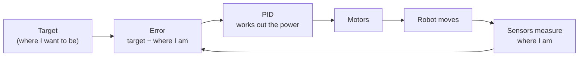

# Lesson 3: PID, or how the robot fixes its own mistakes

**Big question:** How does the robot decide how much power to use?

**In this lesson:** the `PID` class, and the `TURN_...`, `DRIVE_...` and `HEADING_...` settings in
[`src/main.py`](../../src/main.py).

**Before this:** [Lesson 2](02-measuring.md).

---

## The idea

Imagine telling the robot "drive 600 mm." The simplest program would be:

> Full power until you reach 600 mm, then stop.

That doesn't work. At full speed the robot has momentum, so it rolls **past** 600 mm before it can
stop. That's called **overshoot**.

Think about how a person stops a bike at a line. You don't pedal as hard as you can and then slam the
brakes. You:

1. **slow down as you get close** (that's **P**),
2. **brake harder if you're coming in fast** (that's **D**),
3. **creep forward if you stopped a bit short** (that's **I**).

That's **PID**. Each loop (50 times a second) the robot asks "how far am I from where I want to be?"
and picks its power from the answer.

## The error

Everything starts with the **error**: how much is left to do.

```
error = where I want to be − where I am
```

- For a turn: `error = angle_diff(target, heading_now())`, in degrees.
- For a drive: `error = distance wanted − distance moved`, in millimeters.

When the error is 0, the robot is exactly there.

## The feedback loop



The robot measures, works out the power, moves, and measures again. This is called a **closed
loop**: the result of each move feeds back into the next decision.

## P: push in proportion to the error

```
P = KP × error
```

Far away means a big error and a big push. Close means a small error and a gentle push.

**Example with turns:** `TURN_KP = 0.9`, so the robot pushes with 0.9% power for each degree it
still has to turn.

| Error left | 0.9 × error | After the limits (lesson 4) |
|---|---|---|
| 90° | 81% | 50% (capped at `TURN_MAX_SPEED`) |
| 40° | 36% | 36% |
| 10° | 9% | 9% |
| 5° | 4.5% | 6% (raised to `TURN_MIN_SPEED`) |
| 0.5° | 0.45% | stop: it's inside `TURN_TOLERANCE` (1°) |

The robot turns fast at the start and slows down smoothly as it gets close.

- **KP too big:** it's still fast when it arrives, so it overshoots and wobbles back and forth.
- **KP too small:** it's slow, and it may stop before it gets there.

## D: the brakes

P alone still overshoots, because it only looks at **where** the robot is. It doesn't care how
**fast** the robot is going. D fixes that.

```
how fast the error changes = (error now − error last time) ÷ seconds between them
D = KD × how fast the error changes
```

When the robot rushes toward the target, the error shrinks fast. That "how fast" number is
negative, so D is negative, and it **takes power away**. It's braking.

### The math: a worked example

The robot is turning toward 90°. Last loop the error was 30°. Now, 20 ms (0.02 seconds) later, it's
27°.

```
change    = 27 − 30         = −3 degrees
how fast  = −3 ÷ 0.02       = −150 degrees per second
D         = 0.06 × −150     = −9%
P         = 0.9 × 27        = 24.3%
power     = 24.3 + (−9)     = 15.3%
```

P alone would use 24.3%. D sees the robot coming in fast and cuts it to 15.3%.

If the robot were moving slowly, say from 27° to 26.5°, then how fast = −0.5 ÷ 0.02 = −25, and
D = 0.06 × −25 = −1.5%. D brakes only a little, because there's not much speed to stop.

- **KD too small:** overshoots like P alone.
- **KD too big:** slow and jerky, because it brakes too much.

## I: fixing the leftover

Sometimes the robot stops 2° short and P is too weak to finish (0.9 × 2 = only 1.8%). I keeps a
**running total** of the error over time:

```
total = total + error × seconds
I = KI × total
```

The longer the robot sits short of the target, the bigger the total gets and the harder I pushes.
It's like getting more and more impatient.

In this program **`KI` is 0** everywhere, so I is switched off. The simpler fix in lesson 4
(`keep_moving()`) handles stopping short. I is there in case you need it later.

**`i_zone`:** the running total only adds up when the robot is close (within `TURN_I_ZONE`, which is
10°). Far away, the total is reset to 0. Without that, the total would grow huge during a long turn
and make the robot overshoot when it arrives. That problem is called **windup**.

## The code

```python
class PID:
    # error in -> power out. P = push by the error, I = fix a small
    # leftover (only inside i_zone), D = brake as the error shrinks.
    def __init__(self, kp, ki, kd, i_zone):
        self.kp = kp
        self.ki = ki
        self.kd = kd
        self.i_zone = i_zone
        self.integral = 0.0
        self.last_error = 0.0
        self.last_time = None

    def update(self, error):
        now = now_ms()
        output = self.kp * error
        if self.last_time is not None:
            seconds = (now - self.last_time) / 1000.0
            if seconds > 0:
                if self.ki != 0 and abs(error) < self.i_zone:
                    self.integral += error * seconds
                else:
                    self.integral = 0.0
                output += self.kd * (error - self.last_error) / seconds
        output += self.ki * self.integral
        self.last_error = error
        self.last_time = now
        return output
```

**`__init__`** runs once, when a PID is made. It saves the three tuning numbers and starts the
memory: no running total yet, and no "last time" yet (`None`).

**`update(error)`** runs every loop:

| Line | What it does |
|---|---|
| `output = self.kp * error` | The P part. |
| `if self.last_time is not None:` | Skip D and I on the very first loop, because there's no "last time" to compare with yet. |
| `seconds = (now - self.last_time) / 1000.0` | Time since the last loop, turned from milliseconds into seconds. |
| `if seconds > 0:` | Never divide by zero. That would crash the program. |
| `if self.ki != 0 and abs(error) < self.i_zone:` | Add to the running total only if I is turned on and the robot is close. |
| `else: self.integral = 0.0` | Far away (or I turned off): reset the total, to stop windup. |
| `output += self.kd * (error - self.last_error) / seconds` | The D part. |
| `output += self.ki * self.integral` | The I part. |
| `self.last_error = error` and `self.last_time = now` | Remember this loop for next time. |

### How the moves use it

```python
pid = PID(TURN_KP, TURN_KI, TURN_KD, TURN_I_ZONE)
...
wanted = pid.update(error)
```

Every move makes a **new** PID at its start, then calls `update()` every loop.

## Units: why the turn and drive numbers are different

| Setting | Value | Units |
|---|---|---|
| `TURN_KP` | 0.9 | % power per **degree** |
| `DRIVE_KP` | 0.4 | % power per **millimeter** |
| `HEADING_KP` | 1.5 | % steering per **degree** |

A turn's error is measured in degrees and a drive's in millimeters, so they need different numbers.
A 600 mm drive starts with an error of 600, so the push is 0.4 × 600 = 240%, which gets capped at
`DRIVE_MAX_SPEED` (60%). The robot only starts slowing down when it's within 150 mm, because
0.4 × 150 = 60.

## Why it's built this way

- **One class, three jobs.** The same `PID` class runs turns, drive distance and heading hold. Write
  it once, fix it once, understand it once.
- **A class, because PID needs memory.** It has to remember the last error, the last time and the
  running total between loops. A normal function forgets everything when it returns. An object
  keeps its memory.
- **A fresh PID for every move.** Leftover memory from the last move (like an old running total)
  can't leak into the next one. `drive()` even uses **two** PIDs at the same time, one for distance
  and one for heading. That's easy with a class: two objects from the same blueprint.
- **Start simple.** I is off (`KI = 0`). Only add complexity when a test shows you need it.
- **All the tuning numbers are settings** at the top of the file, with comments that say which way
  to change them.

## Try it

1. **On paper:** using `DRIVE_KP = 0.4`, fill in P for errors of 600, 200, 100, 50 and 10 mm. Then
   cap each answer at 60%.
2. **On the robot (change one number at a time):**
   - Run the turn test: put `turn_to(90)`, `turn_to(180)`, `turn_to(270)`, `turn_to(360)` and
     `return` at the top of `routine()` (see the [robot guide](../robot-guide.md)). Write down the
     final error: 360 minus the `Heading` on the done screen.
   - Set `TURN_KP = 1.5` and run it again. Watch for overshoot.
   - Set `TURN_KP = 0.4` and run it again. Is it slower? Does it stop short?
   - Put `TURN_KP` back to 0.9. Now try `TURN_KD = 0`, then `0.06`, then `0.15`. Compare the
     overshoot each time.
3. **Act it out:** one student is the robot and walks toward a line on the floor. Another student is
   the PID and calls out how fast to walk: "far, go fast!", "close, go slow!", "you're rushing,
   brake!"

## Check your understanding

1. `DRIVE_KP = 0.4` and the robot is 100 mm away. What's P?
2. During a drive, the error went from 50 mm to 44 mm in 20 ms. With `DRIVE_KP = 0.4` and
   `DRIVE_KD = 0.02`, what is the total power?
3. Why does every move make a new PID instead of sharing one?
4. What problem does `i_zone` prevent?
5. Why does `update()` skip the D part on its very first loop?

<details>
<summary>Answers</summary>

1. 0.4 × 100 = 40%.
2. P = 0.4 × 44 = 17.6%. How fast = (44 − 50) ÷ 0.02 = −300 mm per second.
   D = 0.02 × −300 = −6%. Total = 17.6 − 6 = 11.6%.
3. So memory from the last move (last error, running total) can't mess up the new move.
4. Windup: the running total growing huge while the robot is still far away, then making it
   overshoot.
5. D needs the last error and the last time. On the first loop there isn't one yet.

</details>

## Teacher notes

- **Time:** 60 minutes. This is the most important lesson. Split it in two if you need to: P and the
  feedback loop first, then D and I.
- **No calculus needed.** D is "how fast the error is changing" and I is "a running total." For
  students who know slope, D is the slope of the error-over-time graph.
- **The act-it-out exercise works well.** Do it before showing any code.
- **Watch the signs.** Students often expect D to always be positive. Stress that a shrinking error
  makes D negative, and negative means braking.
- **Tuning on the robot:** insist on changing one number at a time and writing down what happened.
  That's the scientific method (lesson 9).
